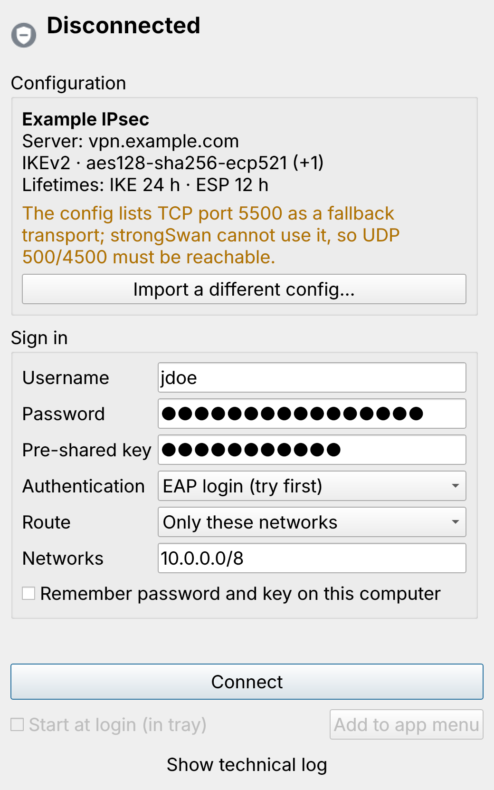
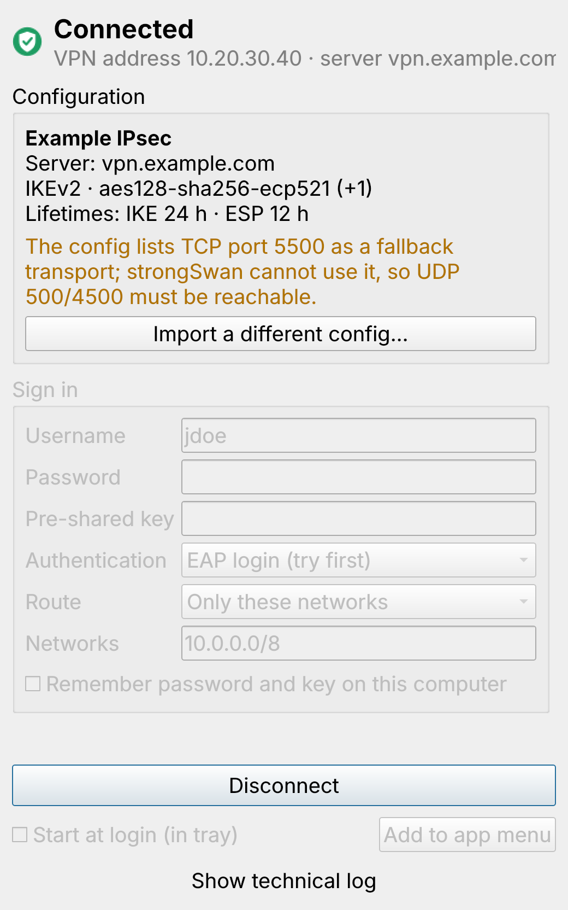
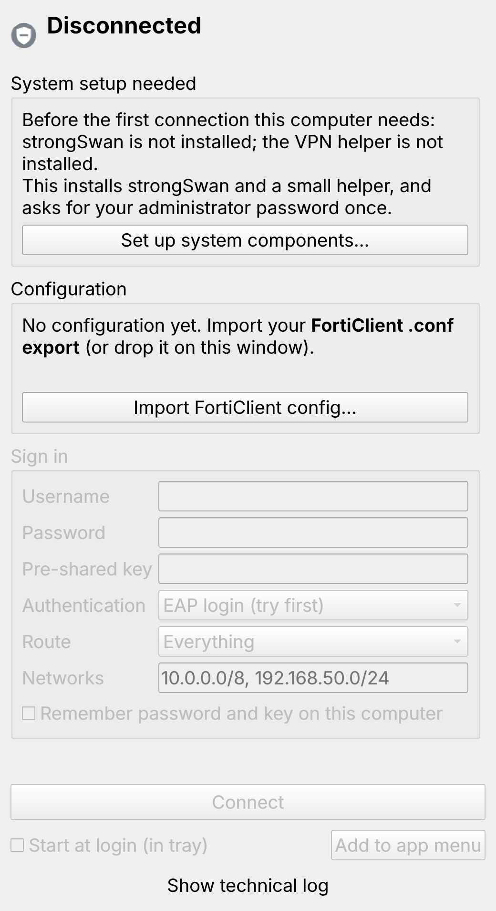
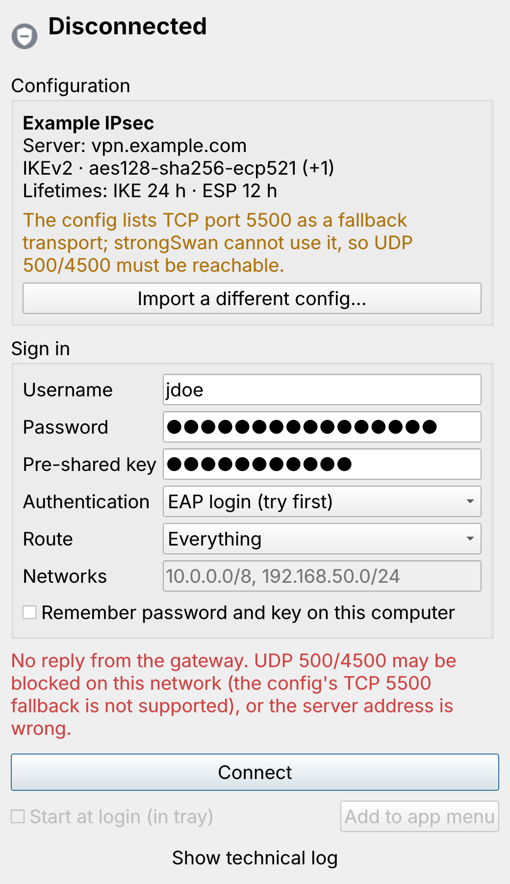
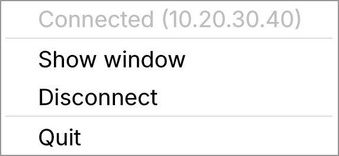
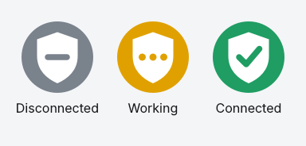

# IPSec VPN - Design By Rashid

A Linux desktop client for **FortiGate IPsec VPNs (IKEv2, pre-shared key + username/password)**. Import the
`.conf` export from the Windows FortiClient, enter your credentials, and connect: no hand-written strongSwan
configuration. It lives in the system tray, shows notifications, and ships as a single AppImage.

<p align="center">
  
  &nbsp;&nbsp;
  
</p>

## Features

- **Uses your existing FortiClient config**: server, IKE/ESP proposals, Diffie-Hellman group, lifetimes,
  dead-peer detection and server-assigned address are read from the export and translated to strongSwan.
- **System tray**: the icon is grey (disconnected), amber (working) or green (connected). Left-click shows or
  hides the window; right-click gives Connect / Disconnect / Quit. Closing or minimising keeps it running.
- **Desktop notifications** on connect, disconnect, failure and when the tunnel drops unexpectedly.
- **Split tunnel**: send everything through the VPN, or only the networks you list (for example `10.0.0.0/8`).
- **Plain-language errors**: "No reply from the gateway…" instead of a wall of IKE log. The technical log is
  one click away and collapsed by default.
- **Convenience**: remember credentials (optional), one-click connect from the tray, start at login,
  add to the application menu, single instance, larger readable UI, scrolls on small screens.
- **Also a CLI** (`--cli connect | disconnect | status | show`) and a browser-based UI for headless use.

<p align="center">
  
  &nbsp;
  
  &nbsp;
  <br>
  
</p>

## Quick start (AppImage)

1. Download `IPSec-VPN-Design-By-Rashid-<version>-x86_64.AppImage` from the
   [Releases](../../releases) page, make it executable and run it:
   ```bash
   chmod +x IPSec-VPN-Design-By-Rashid-*-x86_64.AppImage
   ./IPSec-VPN-Design-By-Rashid-*-x86_64.AppImage
   ```
2. **First run only**: press **Set up system components…**. After one administrator-password prompt it installs
   strongSwan and a small root-owned helper.
3. Press **Import FortiClient config…** (or drop the `.conf` on the window).
4. Enter your username, password and the **pre-shared key**, then press **Connect**.

> **Where do I get the config and the key?** Export the configuration from FortiClient on Windows
> (Settings → backup configuration), or ask your VPN administrator. The pre-shared key and username are stored
> *encrypted* in that file and cannot be read by this app, so you type them in once. Tick **Remember** to
> keep them on your computer (`~/.config/ipsec-vpn/secrets.json`, mode 0600, not encrypted).

**Authentication mode.** Leave it on *EAP login (try first)*. If the gateway answers "authentication failed" and
you are sure the credentials are right, try *PSK, then EAP*.

## Requirements

- Debian/Ubuntu-based Linux on x86-64 (developed and used on Q4OS). The automatic first-run setup uses `apt`;
  on other distributions install strongSwan (`swanctl`, `charon-systemd`, EAP plug-ins) yourself first.
- A desktop with a system tray or status-notifier host (KDE Plasma and most panels). Without one the app still
  works, but closing the window quits it.
- `pkexec` (polkit) for the one-time setup prompt. Without it, run
  `sudo ./IPSec-VPN-Design-By-Rashid-*.AppImage --system-setup` in a terminal.
- If the AppImage will not start because FUSE is missing, install `libfuse2` (`libfuse2t64` on newer Debian) or
  run it with `APPIMAGE_EXTRACT_AND_RUN=1`.

## How it works

```
 tray + window (your user, PyQt5)
        │  JSON request over stdin
        ▼
 sudo -n ipsec-vpn-helper   (root-owned, validates every field, no shell)
        │  writes a 0600 swanctl config, loads it, initiates the tunnel, deletes the file
        ▼
 swanctl / charon-systemd   (strongSwan does the actual IKEv2 + IPsec)
```

| FortiClient export | strongSwan |
|---|---|
| `ike_settings/server` | `remote_addrs` |
| IKE `proposals` + `dhgroup` | `proposals = aes128-sha256-ecp521, …` |
| IPsec `proposals` + `dhgroup` (PFS) | `esp_proposals` |
| `key_life` / `key_life_seconds` | IKE and child `rekey_time` |
| `dpd_retry_interval` | `dpd_delay` |
| `mode_config` | `vips = 0.0.0.0` (server assigns the address) |
| `remote_networks` | `remote_ts` (overridable by the **Route** setting) |
| `xauth` (username/password) | EAP-MSCHAPv2 |

A sanitised example export is in [`examples/sample-forticlient.conf`](examples/sample-forticlient.conf).

## Limitations

- IKEv2 with a pre-shared key and EAP login only. No IKEv1, certificate authentication or IPv6.
- FortiClient's TCP fallback port (for networks that block UDP) is not supported: UDP 500 and 4500 must be
  reachable. On networks that block them you will see "No reply from the gateway".
- Encrypted values (`EncX …`) in the export are not decrypted.
- Linux x86-64 only.

## Security notes

- The UI runs unprivileged. Only the helper runs as root, from root-owned `/usr/local/lib/ipsec-vpn`, and it
  re-validates all input (host names, user names, proposals, networks). Secrets are written hex-encoded so they
  cannot inject configuration, and the config file is removed as soon as the tunnel is up.
- Setup adds a sudoers rule that lets **your user only** run that one helper without a password
  (`/etc/sudoers.d/ipsec-vpn`). Remove it any time with `uninstall.sh` or by deleting the file.
- The browser UI binds to `127.0.0.1` on a random port and requires a per-run token.

## Troubleshooting

| Symptom | Likely cause / fix |
|---|---|
| "No reply from the gateway" | UDP 500/4500 blocked on this network (try another network or a phone hotspot), wrong server, or the gateway restricts source addresses. `sudo tcpdump -ni any 'host <server> and (udp port 500 or udp port 4500)'` shows whether anything comes back. |
| "The gateway rejected the login" | Wrong username, password or pre-shared key, or try the other **Authentication** mode. |
| Connected but internet or local network stops | The config sends *all* traffic through the VPN. Set **Route** to *Only these networks* and list your company networks. |
| Internal names do not resolve | Split tunnel keeps your normal DNS. Use IP addresses, or add the VPN's DNS to your resolver. |
| No tray icon | Your panel has no system-tray / status-notifier widget. |
| Setup prompt does not appear | Run the `--system-setup` command from *Requirements* in a terminal. |

## Build from source

```bash
# run the app directly (needs Python 3.9+ and PyQt5)
pip install PyQt5
python3 -m ipsec_vpn.app                       # window + tray
sudo python3 -m ipsec_vpn.app --system-setup   # one-time system setup
python3 -m ipsec_vpn ui                        # browser UI instead of Qt (stdlib only)

# build the AppImage (needs uv, curl and network access)
packaging/build_appimage.sh

# tests (no root and no real VPN needed: a fake swanctl is used)
python3 -m unittest tests.test_all
python3 tests/qt_e2e.py /tmp                    # needs PyQt5; offscreen UI test
python3 tools/make_screenshots.py docs/screenshots
```

Plain command-line install without the AppImage (CLI and browser UI only): `sudo ./install.sh`, remove with
`sudo ./uninstall.sh`.

**Upgrading from a pre-rename build:** settings are migrated automatically and the old helper, sudo rule and
launchers are removed during **Set up system components…**.

```
ipsec_vpn/      application (forti.py parser/renderer, helper.py root helper, qt_app.py UI, cli.py, webui.py, …)
packaging/      AppImage build script, desktop entry
examples/       sanitised sample FortiClient export
tests/          unit tests and UI / tray end-to-end tests
tools/          screenshot generator
docs/           screenshots
```

## License

GPL-3.0-or-later, see [LICENSE](LICENSE). (The AppImage bundles PyQt5, which is GPL-3.)

This project is unofficial and not affiliated with or endorsed by Fortinet. *FortiClient* and *FortiGate* are
trademarks of Fortinet, Inc.
